# 🌾 KisanMandi — Mandi Prices, Direct Selling & Farm Budget

> ### 📥 Download the APK & watch the demo video
> **[➡️ Open the Google Drive folder](https://drive.google.com/drive/folders/1OT8kPSaK-WprHuD1CthFvOJTvK2cBUfS?usp=sharing)**
>
> The folder has the **Android APK** (install it on any Android phone) and a **video walkthrough** of the whole app.
> A designed PDF version of this README is in [`KisanMandi-README.pdf`](KisanMandi-README.pdf).

**KisanMandi** is a mobile app that helps **farmers in Sindh, Pakistan** get a fair price for their crops and helps **buyers** buy straight from farms.

Farmers see today's wholesale (mandi) prices, compare markets and set price alerts. They list their produce, receive offers from buyers, negotiate in the app and track their stock, costs and profit on one dashboard. Buyers search the marketplace, say **how many maund they want and at what price**, and close the deal in chat. Both get a 7-day weather forecast with farm warnings, and an AI assistant (**Kisan Dost**) that understands Urdu, Sindhi and English, typed or spoken.

> A farmer standing in the mandi often agrees a price without knowing what the next mandi pays, how much the crop actually cost to grow, or that heavy rain is coming on Friday. KisanMandi puts all three in their pocket.

**Contents**
1. [The app](#1-the-app): screenshots, features, how farmers and buyers use it, demo accounts
2. [Tech stack](#2-tech-stack)
3. [The code](#3-the-code): architecture, folders, API, database, sign-in, running it

---

# 1. The app

## 📱 Screenshots

<table>
  <tr>
    <td align="center">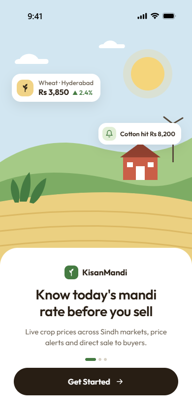<br/><b>Welcome</b><br/><sub>onboarding slides</sub></td>
    <td align="center">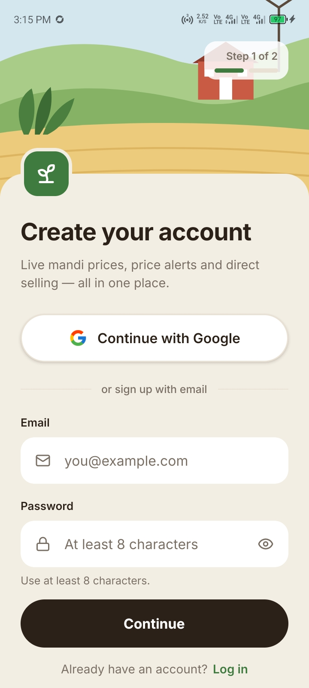<br/><b>Create account</b><br/><sub>email or Google</sub></td>
    <td align="center">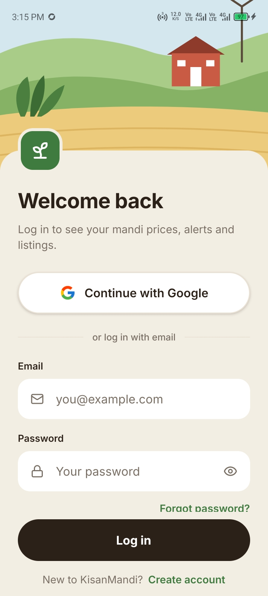<br/><b>Log in</b><br/><sub>with password reset</sub></td>
    <td align="center">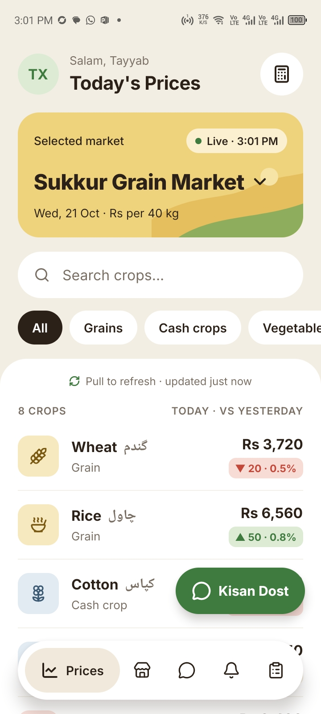<br/><b>Today's prices</b><br/><sub>per mandi, daily change</sub></td>
  </tr>
  <tr>
    <td align="center">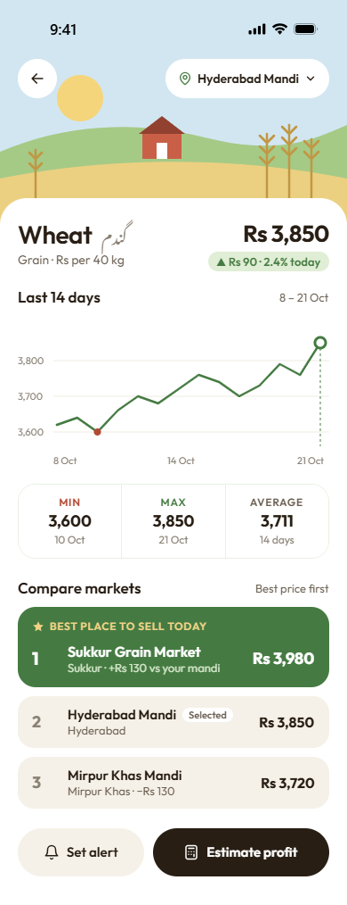<br/><b>Crop detail</b><br/><sub>14-day trend, best mandi</sub></td>
    <td align="center">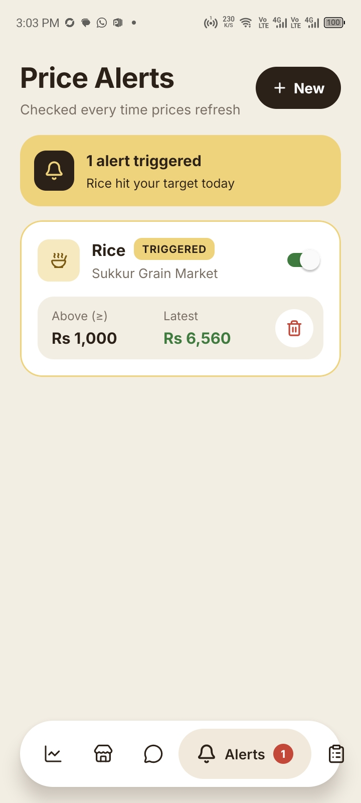<br/><b>Price alerts</b><br/><sub>above / below a target</sub></td>
    <td align="center">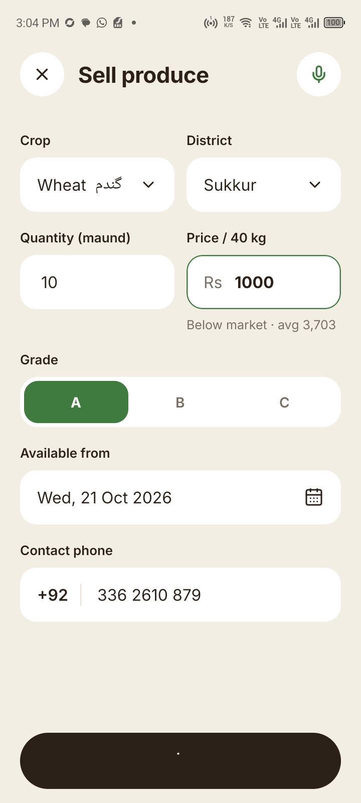<br/><b>Sell produce</b><br/><sub>fill the form by voice</sub></td>
    <td align="center">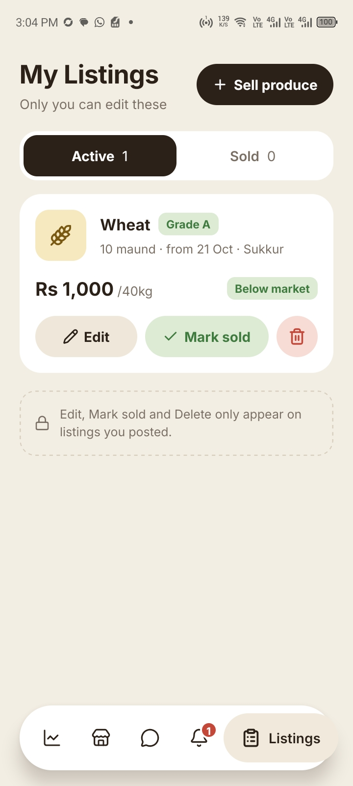<br/><b>My listings</b><br/><sub>edit, mark sold, chats</sub></td>
  </tr>
  <tr>
    <td align="center">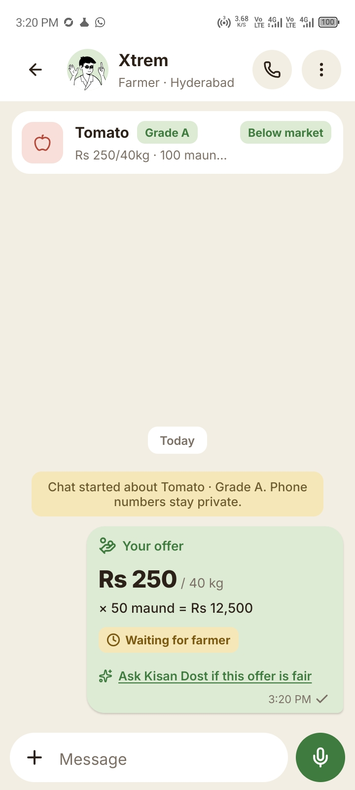<br/><b>Chat & offers</b><br/><sub>maund × price, negotiate</sub></td>
    <td align="center">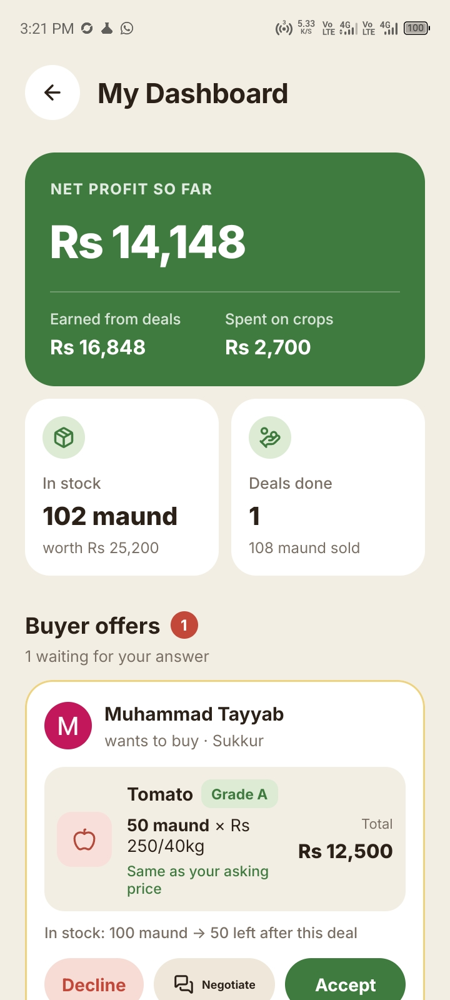<br/><b>Farmer dashboard</b><br/><sub>profit, stock, buyer offers</sub></td>
    <td align="center">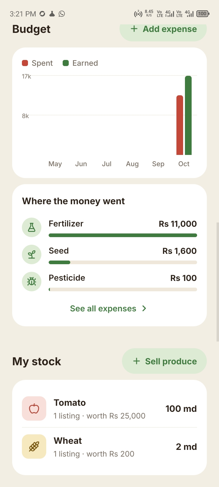<br/><b>Budget & stock</b><br/><sub>spent vs earned, expenses</sub></td>
    <td align="center">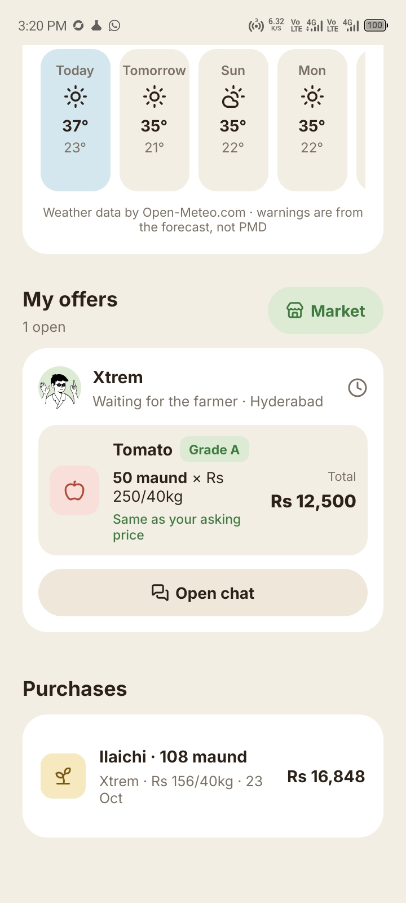<br/><b>Buyer dashboard</b><br/><sub>weather, offers, purchases</sub></td>
  </tr>
  <tr>
    <td align="center">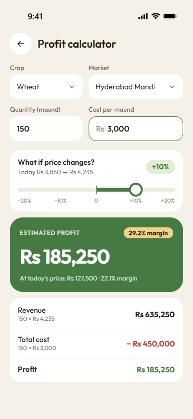<br/><b>Profit calculator</b><br/><sub>±20% what-if</sub></td>
    <td align="center">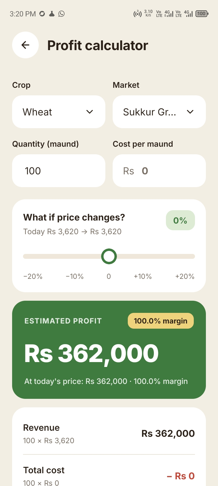<br/><b>Profit calculator</b><br/><sub>on a real phone</sub></td>
    <td align="center">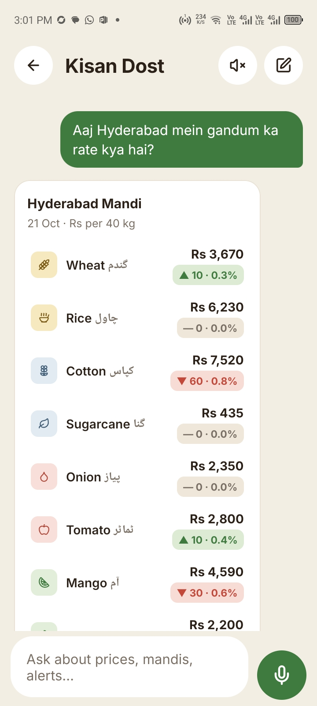<br/><b>Kisan Dost</b><br/><sub>AI assistant with voice</sub></td>
    <td></td>
  </tr>
</table>

Design references for every screen are in [`references/`](references/).

## ✨ Features

### 📈 Know the market
- **Today's prices** for the chosen mandi in **Rs per 40 kg (one maund)**, with the change since yesterday in rupees and percent.
- Search crops, filter by type (grains, cash crops, vegetables, fruits), pull down to refresh.
- **Crop detail**: a 14-day price chart with lowest, highest and average, and every mandi ranked by price so the best place to sell stands out.
- **"Sell now or wait?"**: AI advice that reads the trend and the other mandis and gives a short verdict with reasons.
- **Price alerts**: "tell me when wheat in Sukkur goes above Rs 3,800". Alerts are checked every time prices refresh, show a badge on the Alerts tab and can also arrive by **email**.
- **Profit calculator**: quantity × today's price minus your cost, with a slider to see what happens if the price moves up to 20% either way.

### 🧺 Sell and buy directly
- **Sell produce**: crop, quantity in maund, asking price, grade A/B/C, district, available-from date and phone. The whole form can be **filled by speaking** ("10 maund wheat, grade A, 3700 per 40 kg").
- **Marketplace**: search, filter by crop, district and grade, sort by newest or cheapest. Each listing shows whether its price is **below, at or above** the market average (within ±5% counts as "at market").
- **Listing page**: price compared to the market, stock, seller, plus **Make offer**, **Chat**, **Call** and **WhatsApp**.
- **Only the owner** can edit a listing, mark it sold or delete it.

### 🤝 Offers, negotiation and deals
- A buyer taps **Make offer** and enters **how many maund** they want and **their price**. The app shows how much stock would stay with the farmer.
- The farmer gets the offer as a **notification on the dashboard** and as a card in the chat, with **Accept**, **Negotiate** and **Decline**.
- **Negotiate**: either side can send a **counter offer**. The newest offer replaces the old one, and whoever didn't send it answers it.
- **Accept = deal.** The quantity is **taken out of the farmer's stock** (a listing that reaches 0 becomes "sold"). The deal is saved for both sides and a "Deal done" note appears in the chat.
- **Chat like WhatsApp**: text, **voice notes**, **photos** and offers. Read ticks, unread badges, archive, delete for me, block and report. Phone numbers stay private unless the farmer shares them.
- Not sure about an offer? **"Ask Kisan Dost if this offer is fair"** compares it with today's mandi prices.

### 📊 Farmer dashboard
- **Net profit so far**: money earned from deals minus money spent on crops.
- **Stock**: maund still listed and what it's worth; **deals done** and maund sold.
- **Buyer offers** waiting for an answer, with Accept / Negotiate / Decline right there.
- **Budget chart**: spent vs earned for each of the last 6 months, and **where the money went** (seed, fertilizer, pesticide, labour, water, machinery, transport, other).
- **Crop costs**: what each crop cost and earned, and its profit or loss.
- **Expenses**: add, edit and delete what you spent on each crop.
- **Recent deals** with buyer, quantity, price and total.

### 🛒 Buyer dashboard
- Total bought, maund bought and number of deals.
- **My offers**: which are waiting for the farmer and which are waiting for you (counter offers).
- **Purchases** list, and a shortcut back to the marketplace.

### 🌦️ Weather for farming
- Current weather and a **7-day forecast** for your district (temperature, rain chance), from **Open-Meteo**.
- **Farm warnings** with simple advice, worked out from the forecast:

  | Warning | When | Advice in the app |
  | --- | --- | --- |
  | Hail storm | hail in the forecast | harvest ripe produce early, keep stock and animals under a roof |
  | Thunderstorm | thunderstorm in the forecast | cover harvested crop and bags, don't spray during lightning |
  | Heavy rain | 20 mm or more (watch: 10 mm at ≥ 50% chance) | cover stock, clear drains, hold off on fertilizer and spraying |
  | Strong wind | gusts of 60 km/h or more (watch: 45) | don't spray, tie down tarps and sheds |
  | Heatwave | 42 °C or more (watch: 40 °C) | irrigate morning or evening, shade and water for animals |
  | Frost | 3 °C or less | light evening watering, cover nursery plants |

- The most serious warning is also shown on the **Home** screen.
- These are worked out from the forecast numbers. They are not official PMD (Pakistan Meteorological Department) alerts.

### 🤖 Kisan Dost: AI assistant
- Ask in **Urdu, Sindhi or English**, typed or by **holding the mic**: *"Aaj Hyderabad mein gandum ka rate kya hai?"*
- Answers come from the app's real data (today's prices, trends, mandi comparison, marketplace search, your alerts, profit estimates).
- It can **create a price alert** for you, but always shows a confirmation card first.
- Replies can be **read aloud**, and price tables and cards appear inside the chat.

### 🔌 Use your data in ChatGPT or Claude
Each user can create a personal, **read-only link** (an MCP server) in the app. Added to ChatGPT or Claude, it lets those assistants look up that user's prices, markets, listings and alerts. The link can be replaced at any time.

### 🛡️ Admin panel
- **Mandi requests**: farmers and buyers can ask for a missing mandi; the admin approves or rejects.
- **Markets**: add and edit mandis.
- **Prices**: publish today's prices for a mandi (the app then shows "Published by …").
- **Messages**: read "Contact admin" messages from users and mark them done.

### 🧩 Everyday details
- **Sign up** with email + password (6-digit email code) or **Google**; **forgot password** by email code.
- Searchable picker with **every district in Pakistan**; crop names in **Urdu** next to English.
- Profile: edit details, choose your default mandi, switch email alerts on or off, delete account.
- Avatars, haptic feedback, themed dialogs and sheets that match the app's look.
- A daily job at 00:05 Pakistan time rolls prices forward, so "today" is always today.

## 🔁 How it works

### Farmer journey

<p align="center">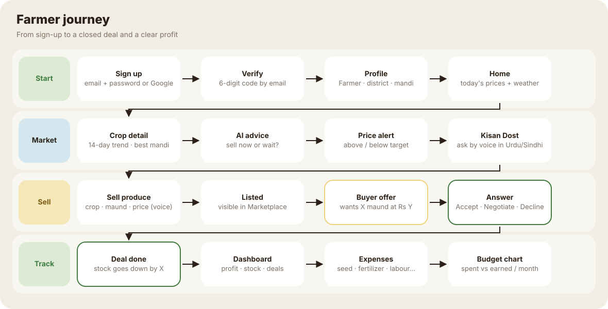</p>

1. **Start**: sign up (or Google), verify the email code, choose **Farmer**, your district and your mandi.
2. **Know the market**: check today's prices and the weather on Home, open a crop for its trend and the best mandi, ask for AI advice, set alerts.
3. **Sell**: post produce (or speak it). Buyers see it in the Marketplace and send offers.
4. **Deal**: accept, negotiate with a counter offer, or decline. Accepting lowers your stock automatically.
5. **Track**: the dashboard shows profit, stock and deals. Add expenses per crop to see the budget chart and each crop's profit.

### Buyer journey

<p align="center">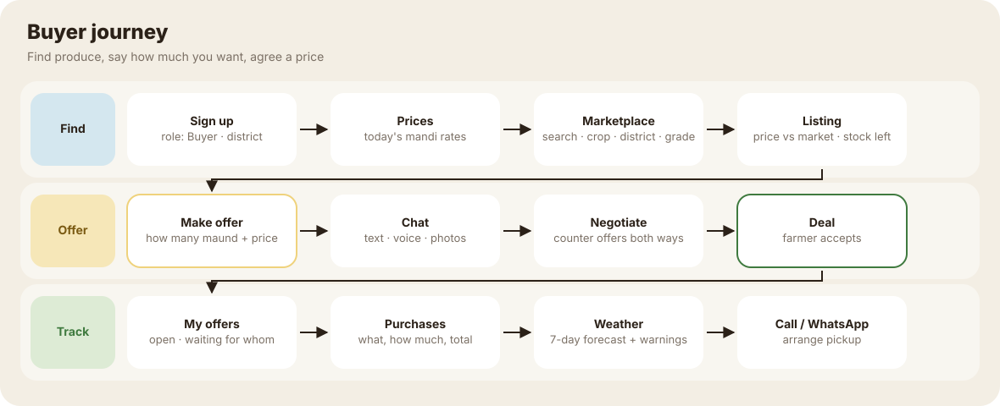</p>

1. **Find**: sign up as **Buyer**, check prices, search the marketplace by crop, district and grade.
2. **Offer**: open a listing, tap **Make offer**, enter how many maund and your price.
3. **Negotiate** in chat (text, voice, photos, counter offers) until one side accepts.
4. **Track** open offers and purchases on your dashboard, then call or WhatsApp the farmer to arrange pickup.

### From offer to deal

<p align="center">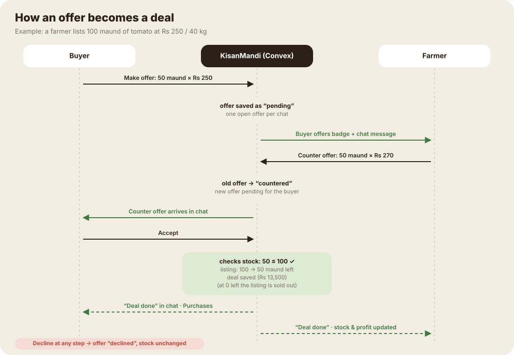</p>

- Each chat has **at most one open offer**. A new offer marks the previous one **"countered"**.
- On accept, the server checks the offer still fits the stock, then in one step: lowers the listing's quantity (or marks it sold at 0), saves the deal, and posts "Deal done" in the chat.
- Declining leaves the stock unchanged.

## 🔑 Demo accounts

| Role | Email | Password | What to try |
| --- | --- | --- | --- |
| 🛡️ Admin | `admin@cocomo.com` | `cocomo123` | Profile → **Admin panel**: mandi requests, markets, publish prices, messages |
| 🧑‍🌾 Farmer | `tayyabxtrem@gmail.com` | `123123123` | Dashboard, buyer offers, expenses, budget chart, sell produce, alerts |

> These are demo logins for the hackathon. Change the passwords (or remove the accounts) before using the app for real.

To try the **buyer** side, create a new account and choose **Buyer**, then make an offer on one of the farmer's listings.

---

# 2. Tech stack

| Layer | Technology | Used for |
| --- | --- | --- |
| Mobile app | **React Native 0.86 + Expo SDK 57** | One codebase for Android, iOS and web |
| Navigation | **Expo Router** | File-based screens in `src/app/`, tabs that change with the user's role |
| Styling | **NativeWind** (Tailwind), **Inter** font | Custom UI kit in `src/components/kisan/` |
| Backend | **Convex** | Database, REST API, realtime chat, scheduled jobs, file storage |
| Sign-in | **Better Auth** (`@convex-dev/better-auth`) | Email + password with 6-digit code, Google, password reset, sessions |
| Email | **Resend** | Verification codes, password reset, price-alert emails |
| AI | **AWS Bedrock** (Claude Haiku 4.5) via the Vercel AI SDK + `@convex-dev/agent` | Kisan Dost assistant, "sell now or wait?", voice → listing form |
| Speech | **Groq Whisper** (speech → text), `expo-speech` (text → speech) | Voice questions, voice-filled forms, reading answers aloud |
| Weather | **Open-Meteo** (forecast + geocoding, no API key) | 7-day forecast and farm warnings per district |
| AI connectors | **MCP** (Model Context Protocol) over HTTP | Read-only link for ChatGPT / Claude |
| Rate limits | `@convex-dev/rate-limiter` | Fair use of the AI assistant and sign-up checks |
| Charts | `react-native-gifted-charts`, plus custom bar charts | 14-day price line, monthly budget bars |
| Forms & validation | `react-hook-form` + **zod** | The same zod rules check input in the app and on the server |
| Device | `expo-audio`, `expo-image-picker`, `expo-camera`, `expo-haptics`, `expo-clipboard` | Voice notes, photos, haptics |
| State & dates | `zustand`, `date-fns` | Cached API data, Pakistan-time dates |
| Icons & images | `lucide-react-native`, `expo-image`, DiceBear avatars | Icons, fast images, default avatars |

---

# 3. The code

## 🏗️ Architecture

<p align="center">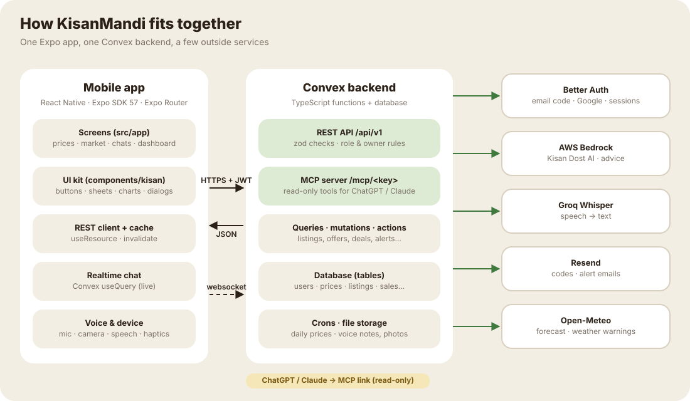</p>

- The app reads and writes through a **REST API** (`/api/v1/...`) on the Convex HTTP host. Every request carries the user's sign-in token.
- Every endpoint **checks input with zod** and checks **who is asking**: signed in, profile finished, farmer only, admin only, or owner of the record.
- **Chat** reads use Convex's live queries over a websocket, so new messages appear instantly. Sending still goes through the REST API.
- After a change, the app calls `invalidate("/listings", "/dashboard", …)` so cached screens refresh.
- Errors always look like `{ "error": { "code", "message", "field?" } }`: `400` bad input, `401` signed out, `403` not allowed, `404` not found.
- API keys (Bedrock, Groq, Resend, Google) live **only in Convex environment variables**, never in the app.

## 📂 Project structure

```
src/app/                         every file is a screen (Expo Router)
├── _layout.tsx                  root stack, fonts, sign-in guard
├── index.tsx · welcome.tsx      first launch → onboarding slides
├── profile-setup.tsx            sign up · log in · Google · email code · reset password · edit profile
├── (tabs)/                      prices (Home) · marketplace · chats · alerts · listings · profile
├── dashboard.tsx                farmer: profit, offers, budget, stock, crop costs · buyer: offers, purchases
├── expenses.tsx · expense-form.tsx   crop expenses list and add/edit form
├── crop/[cropId].tsx            14-day chart, compare mandis, AI advice
├── listing/[id].tsx             listing page: Make offer, Chat, Call, WhatsApp (owner: edit, sold, delete)
├── chat/[id].tsx                chat with offers, counter offers, accept / decline
├── sell.tsx · alert-form.tsx    listing form (voice fill) · price alert form
├── profit.tsx                   profit calculator
├── assistant.tsx                Kisan Dost AI assistant
├── connect-ai.tsx               ChatGPT / Claude link
└── admin.tsx · admin/market/    admin panel and per-market price entry

src/components/kisan/            UI kit
├── ui.tsx                       Button, Chip, Sheet, ConfirmDialog, SelectSheet, StateView…
├── use-confirm.tsx              themed yes/no dialog hook
├── chat/                        message bubbles, offer sheet, composer, voice player
├── dashboard/                   offer card, budget chart, expense types
├── weather/                     weather card and warning boxes
└── prices/ · market/ · sell/ · assistant/
src/lib/api/                     REST client, cached resources (useResource), response types
src/hooks/use-voice-input.ts     record → Whisper → text

convex/                          backend
├── schema.ts                    all tables and indexes
├── rest/routes.ts               REST API (users, prices, alerts, listings, dashboard, expenses, weather, AI)
├── rest/chat_routes.ts          chat + offer endpoints
├── rest/assistant_routes.ts     Kisan Dost endpoints
├── rest/mcp.ts                  MCP server for ChatGPT / Claude
├── lib/kisan.ts                 shared rules + zod schemas (used by app AND server)
├── lib/weather.ts               weather codes and farm-warning rules
├── listings.ts · prices.ts · alerts.ts · crops.ts · markets.ts
├── conversations.ts · messages.ts   chat, offers, counter offers, accepting a deal
├── dashboard.ts · expenses.ts   dashboard numbers and crop expenses
├── weather.ts                   Open-Meteo fetch + 30-minute cache
├── assistant.ts · ai.ts · advice.ts   AI assistant, Bedrock / Groq actions
├── auth.ts · users.ts · account.ts    Better Auth, user profile, delete account
├── admin.ts · support.ts · mcp_keys.ts
├── seed.ts · crons.ts           demo data, daily price job
docs/diagrams/                   the SVG diagrams in this README (+ make_diagrams.py)
tests/                           unit tests for the business rules
```

## 🧠 Where the important logic lives

| What | Where | How |
| --- | --- | --- |
| Daily change, market label, alerts, profit maths | `convex/lib/kisan.ts` | Pure functions, shared by the app and the server, unit-tested |
| Making an offer / counter offer | `convex/messages.ts` → `send` | Checks the listing is active and the quantity fits the stock; marks the previous open offer "countered" |
| Accepting a deal | `convex/messages.ts` → `respondToOffer` | Only the other side can answer; lowers stock (sold at 0), saves a `sales` row and posts "Deal done", all in one transaction |
| Dashboard numbers | `convex/dashboard.ts` | Groups stock by crop, adds up expenses and deals per crop, per type and per month |
| Weather warnings | `convex/lib/weather.ts` | Thresholds on the daily forecast; most serious first |
| Weather fetch & cache | `convex/weather.ts` | District → coordinates → forecast, saved per district for 30 minutes; falls back to the last saved forecast |
| Who can call what | `convex/rest/helpers.ts` → `route()` | Access levels `public`, `user`, `profile`, `farmer`, `admin` |

## 🌐 REST API (`/api/v1`)

| Area | Endpoints |
| --- | --- |
| Users | `GET /users/me`, `PATCH /users/me`, `DELETE /users/me` |
| Crops & markets | `GET /crops`, `POST /crops` (farmer), `GET /markets`, `POST`/`PATCH /markets` (admin) |
| Prices | `GET /prices`, `GET /prices/history`, `GET /prices/compare`, `POST /admin/prices` (admin) |
| Alerts (farmer) | `GET /alerts` (re-checks), `POST /alerts`, `GET`/`PATCH`/`DELETE /alerts/:id` |
| Listings | `GET /listings`, `GET /listings/mine`, `GET /listings/:id`, `POST /listings`, `PATCH`/`DELETE /listings/:id` |
| Chat & offers | `GET`/`POST /conversations`, `GET /conversations/:id`, `POST /conversations/:id/(messages\|read\|archive\|block\|report)`, `POST /messages/:id/offer` (accept · decline · markSold), `DELETE /messages/:id`, `POST /chat/upload-url` |
| Dashboard | `GET /dashboard` (farmer or buyer view by role) |
| Expenses (farmer) | `GET /expenses`, `POST /expenses`, `PATCH`/`DELETE /expenses/:id` |
| Weather | `GET /weather` (your district, or `?district=`) |
| AI | `POST /ai/advice`, `POST /ai/parse-listing`, `/assistant/*` |
| Admin & support | `GET`/`POST`/`PATCH /market-requests`, `GET`/`POST /support`, `PATCH /support/:id` |
| MCP | `/mcp/<personal key>` (read-only tools for ChatGPT / Claude) |

## 🗄️ Database (Convex tables)

| Table | What it stores |
| --- | --- |
| `users` | name, email, phone, district, role (farmer / buyer), default mandi, email alerts |
| `crops` · `markets` | crops (with Urdu / Sindhi names, category) and mandis (district) |
| `prices` | price per crop, mandi and day (Rs per 40 kg) |
| `listings` | farmer's produce: crop, quantity (stock), asking price, grade, district, date, status |
| `alerts` | crop, mandi, above / below, target price, active |
| `conversations` · `messages` | chats per buyer per listing; text, voice, photo, offer (price, quantity, status) and system messages |
| `sales` | every accepted offer: farmer, buyer, crop, quantity, price, total, date |
| `expenses` | farmer's costs per crop: type, amount, note, date |
| `weatherCache` | last forecast per district |
| `marketRequests` · `supportMessages` | mandi requests and "Contact admin" messages |
| `mcpKeys` | hashed personal ChatGPT / Claude links |
| `blocks` · `reports` · `adviceCache` | chat safety and cached AI advice |

Better Auth keeps its own tables (`user`, `account`, `session`, `verification`, `jwks`) inside its Convex component; each auth user is copied into `users` automatically.

## 🔐 Sign-in, roles and admin

<p align="center">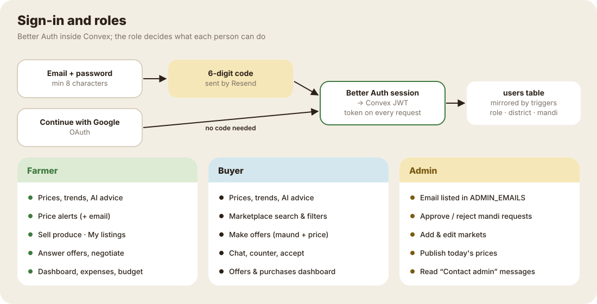</p>

- **Email + password**: on sign-up a 6-digit code is emailed (Resend) and must be entered before the account works. Forgotten passwords are reset with an emailed code too.
- **Google**: "Continue with Google" signs in without a code.
- After sign-in the app gets a **Convex token** and sends it with every request. The server finds the matching row in `users` and applies the role rules.
- **Farmer or Buyer** is chosen in the profile step and decides the tabs and what the API allows (for example, only farmers can post listings or add expenses).
- **Admin** is not a role in the database. Any **verified** email listed in the Convex variable `ADMIN_EMAILS` gets the admin panel:

  ```bash
  npx convex env set ADMIN_EMAILS "admin@cocomo.com"
  ```

- To create or reset an email + password login without sending a verification email (handy for demo accounts):

  ```bash
  npx convex run admin:setupAccount '{"email":"admin@cocomo.com","password":"<password>"}'
  ```

## 🚀 Run it locally

```bash
npm install
npx convex dev                 # keep running: pushes the backend and regenerates types
npx convex run seed:run        # crops, mandis, 14 days of prices, demo users, listings, alerts, chats
npx expo start                 # start the app ("a" = Android, "w" = web)
npx expo run:android           # native development build (needed for Google sign-in, mic, camera)
```

Expo Go isn't enough because the app uses native modules; use a development build (`npx expo run:android` or `npx eas-cli@latest build --profile development`).

More seed commands:

```bash
npx convex run seed:run '{"reset":true}'                       # wipe ALL app data and reseed
npx convex run seed:adoptDemo '{"email":"you@example.com"}'    # give your account the demo listings and alerts
```

### Configuration

The app's public settings (the two Convex URLs) are in `app.json` → `expo.extra` (`convexUrl`, `convexSiteUrl`). Secrets are set **only in Convex**:

```bash
npx convex env set GROQ_API_KEY ...           # Whisper speech to text
npx convex env set AWS_ACCESS_KEY_ID ...      # Bedrock
npx convex env set AWS_SECRET_ACCESS_KEY ...
npx convex env set AWS_REGION us-east-1
npx convex env set RESEND_API_KEY ...         # emails
npx convex env set RESEND_FROM_EMAIL ...
npx convex env set ADMIN_EMAILS ...           # comma-separated admin emails
# Google sign-in and Better Auth: see docs/auth-setup.md
```

Open-Meteo needs no key. Its free plan is for non-commercial use.

### Checks

```bash
npm run typecheck     # app + Convex TypeScript
npm run lint          # expo lint
npm test              # unit tests: prices, alerts, profit, listings, expenses, weather warnings
```

To redraw the diagrams after editing them: `python docs/diagrams/make_diagrams.py docs/diagrams`.

## 📚 More docs

- [docs/plan.md](docs/plan.md): product plan and roadmap
- [docs/auth-setup.md](docs/auth-setup.md): Better Auth, Google and Resend setup
- [docs/ai-bedrock.md](docs/ai-bedrock.md): Bedrock models and configuration
- [docs/ai-groq-voice.md](docs/ai-groq-voice.md): Groq chat, Whisper and text to speech

---

<sub>Prices are in Rs per 40 kg (one maund) and "today" is Pakistan time. Seed data (names, phone numbers, prices) is fictional. Weather data by <a href="https://open-meteo.com/">Open-Meteo.com</a>.</sub>
